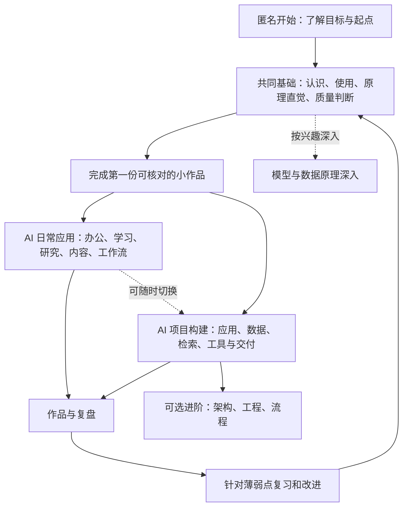
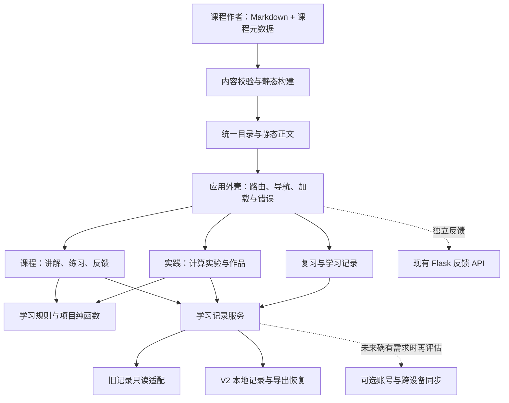

# AI 学习平台 V2：系统架构、学习体验与内容设计

日期：2026-10-21  
状态：整体方案已确认；P1 首页、六步课堂与个人成果已实现并完成本地验证，详情见[核心计划](../../CORE_DEVELOPMENT_PLAN.md)。其余阶段、真实设备与教学效果尚未完成验证。  
对象：所有 AI 初学者；允许零编程经验，以中文学习为主。  
Author: Lliftime

开发入口：[核心开发计划](../../CORE_DEVELOPMENT_PLAN.md)。该计划记录后续确认的教学深度、互动、站内考核展示与正反馈要求；本文件按其确认范围同步，线框不作为已实现或已验收证据。

视觉采用用户提供的方案 A，细节与冲突处理见[视觉与原生适配规范](2026-10-21-visual-a-responsive-spec.md)。旧线框只保留交互结构参考，其配色与比例不作为当前视觉基准。

最新范围：网站由个人维护，当前以自助学习为主，不建设活动区、社区动态、公开作品墙、教师批阅、同伴互评、实时协作或公开排行等需要持续运营的功能。个人成果查看与导出保留；固定教学情境和 Activity 练习不属于运营活动。

## 1. 产品目标与本轮边界

把现有平台重新组织为一个能让初学者**知道从哪里开始、学懂一个问题、动手完成任务、核对成果并继续学习**的系统。

核心定位：**从认识 AI，到可靠使用 AI，再按需要学习构建 AI 应用。**

用户已明确平台面向所有 AI 初学者，可以采用体系化路线；已明确不再采用引用对话的具体内容，由本方案独立设计架构、工程、流程学习。本方案不假定学习者都是程序员，也不把非编程路线视为较低等级。

本轮交付现状判断、产品与技术设计、课程蓝图、关键页面线框、迁移顺序和验收场景。不修改当前运行功能，不提交、不推送、不部署，不改现有学习记录。

已确认共同基础后分流、普适零基础、扎实教学、互动吸收、自助考核与个人成果、具体正反馈、架构/工程/流程进阶，以及方案 A 视觉与原生三档适配。匿名开始、样板无需 API Key、数学推导可选及保留培训集合为当前建议；精确技术与呈现尺寸根据样板实测调整。

## 2. 已有成果与目前的问题

### 2.1 实际基线

权威检查目录：`D:\人工智能训练学习平台\ai-learning-lab`。

检查时分支为 `feat/quiet-learning-workspace`，HEAD 为 `85613ac`。该工作区包含尚未提交的首页、阅读器、样式、构建脚本与 4 篇新增教材；这些均属于现有成果，应保留和甄别复用。父目录的发布包、历史截图和部署结果不是当前源码入口。

本轮只检查了本地源码，并在隔离浏览器上下文查看本地首页、基础课程和教材目录；没有验证线上版本、全部学习行为、真实域名持久化或反馈服务。以下内容数量来自当前磁盘与页面，不代表已发布数量。

| 现有能力 | 实际实现 | 后续用途 |
|---|---|---|
| 基础课程 | 六章、概念卡、144 道基础题、错题与情境任务 | 拆成共同基础的知识与练习素材，保留题目 ID |
| 16 天培训 | 32 单元大纲/任务、64 道补充题与微实验，完整讲解仍需扩写 | 按办公、数据、应用开发等目标重新编组，保留原培训视图 |
| 系统教材 | 当前 12 篇 Markdown、静态 HTML、manifest、阅读与理解检查 | 作为讲解与深入阅读来源，避免再维护一套重复正文 |
| 动手项目 | 标注评估、朴素贝叶斯、词项检索评估、本地日历工具流程 | 保留真实计算与导出能力，关联到具体学习目标 |
| 学习记录 | 多个 localStorage 键，各模块独立记录 | 经统一适配器聚合，逐步补齐导出、恢复和版本迁移 |
| 反馈服务 | Flask + SQLite，处理反馈与管理收件箱 | 继续独立运行，不把反馈数据库当学习数据库 |

主要证据入口：`index.html`、`scripts/build_ui.js`、`scripts/build_textbook.py`、`content/manifest.json`、`content/home.js`、`content/reader.js`、`training/training-ui.js`、`projects/app.js`、`projects/logic.js`、`server/app.py`。

### 2.2 为什么功能增加后仍可能不好学

1. **四套目录缺少明确关系。**“基础六章、系统教材、16 天培训、项目”既有知识重叠，也有深度差别，但入口要求用户先理解内部分类。不同目录的“下一步”不对应同一学习目标。
2. **首页承担了过多发现任务。**当前页面同时有继续学习、四条入口、复习区、另一组待办、教材清单、培训清单和项目目录。信息丰富，但没有围绕新用户第一次成功收敛。
3. **内容顺序不适合所有初学者。**教材将 Prompt 的前置描述为 Transformer，会让只想可靠使用 AI 的人误以为必须先学神经网络。应区分应用前置与原理深入建议。
4. **讲解、练习、项目尚未组成一节完整课程。**正文、卡片、测验、实验在不同模式中切换，缺少“为什么学—跟着做—独立尝试—解释错误—留下成果”的连续体验。
5. **学习记录的含义不统一。**已读、自评、选择题成绩、点击过实验、项目最低条件是不同证据，不能相加得到“AI 掌握度”。
6. **技术边界影响后续内容迭代。**主入口包含大量内容、路由和渲染；各模块依赖全局状态。`build_ui.js` 还从现有 `index.html` 截取课程数据再生成页面，内容来源和构建产物边界需要整理。README 仍描述早期单文件 V1.2，与实际结构失步。

这些是基于源码与页面的设计判断。本轮没有用户访谈、行为数据或学习效果实验，不能据此声称已测得留存、学习效率或满意度提升。

## 3. 产品结构：共同基础 + 两条应用路线 + 可选深入



### 3.1 用户起点

首次访问直接提供“从第一课开始”。可选回答一个问题：“你主要想用 AI 做什么？”选项是日常学习与办公、了解原理、尝试开发应用、还不确定。选择只影响推荐，不锁定内容、不要求注册。

已有经验者可做短起点练习或直接浏览路线。短练习用于推荐，不产生职业能力评级。允许跳课，并在进入时提示需要的概念和补课入口。

### 3.2 产品承诺

- 每节课明确“学完能做什么”，包含一次可操作练习与解释反馈。
- 初学者不安装编程环境也能完成共同基础和第一份作品。
- 每个概念在不同位置有明确角色：入门解释、原理深入、计算实验或项目应用；同一正文不复制维护。
- 推荐说明原因，例如“你已经能写清任务，这节练习帮助你检查输出是否有依据”。
- 用户可以自由探索；“体系化”通过推荐顺序和关联实现。
- 核心主题补齐背景、发展、逐步原理、正反例、完整示范、变式任务与准确引用；短卡片和大纲不代替首次教学。
- 反馈覆盖即时指导、过程改善、阶段成果、作品价值与成长回顾，基于实际练习记录自动呈现，不依赖教师/同伴参与，不把总分或操作完成当掌握证明。

### 3.3 首版范围

第一样板包括公共课程、本地匿名学习、可恢复记录、确定性练习、作品与个人成果页和可用移动端。后续扩展固定自助考核、规则检查、自评量规、修订与导出；不安排教师/同伴或公共社区运营。账号/云同步、联网 AI 助教、云端执行和付费按真实需求另议，不作为当前前置。

核心内容不依赖付费模型。涉及生成式使用时，可采用带明确标识的示例输出、学习者自己选择的外部工具或人工填写练习；不能把示例回放包装成平台实时模型生成。

## 4. 信息架构与关键页面

### 4.1 全站导航

一级导航控制为五个：**学习首页、学习路径、动手实践、复习巩固、我的学习**。

搜索、术语和延伸资源在课程目录或页头提供；反馈和设置在辅助入口。原“基础六章／系统教材／16 天培训”变成内容集合或筛选项，不再作为新手必须判断的三种学习通道。

| 页面 | 用户要解决的问题 | 主要动作 |
|---|---|---|
| 学习首页 | 我现在应该做什么？ | 开始第一课或继续当前任务 |
| 学习路径 | 我想达到这个目标，要学哪些内容？ | 选路线、查看阶段成果、进入课程 |
| 单课工作区 | 这个问题怎么理解、怎么做？ | 学一段、试一次、看解释、再应用 |
| 动手实践 | 我能完成什么任务？ | 按目标进入实验、小任务或综合项目 |
| 复习巩固 | 哪些地方需要再试？ | 到期回忆、错题重做、失败场景练习 |
| 我的学习 | 我做过什么、记录在哪里？ | 查记录、看作品、导出、恢复、调整路线 |

### 4.2 首页

新用户首屏：一句产品说明、一个具体的首次任务、完成后会获得什么、一个主按钮。示例：“把一段活动通知整理成可核对的清单，体验如何给 AI 明确任务并检查结果。”

回访首屏按方案 A 在足够宽度下采用 7:5 任务与成长双栏：当前目标、上次位置、一个继续按钮，以及真实记录快照；窄屏改上下排列。下面最多三个建议任务，可忽略或替换；不得编造完成状态或精确能力指标。

首页不展示完整清单。下半屏用分段标签展示共同基础、应用、构建、进阶，每次突出三张课程卡并可查看全部；再以响应式资源架提供既有教材、练习、项目和专题。数量来自实际目录，不固化原稿数字。

### 4.3 学习路径页

每条路线给出：适合谁、需要什么、会完成什么、阶段顺序、每阶段任务、可跳转的先修知识。时长是编辑估计，用户可自行安排。

阶段显示三类记录：“已阅读”“练习情况”“作品检查”，保持分别可见。未发布的课程不能伪装为可进入内容；开发中的路线明确显示可用部分。

共享基础显示一次；切换路线不重置记录。16 天培训可以保留“按天查看”，底层引用相同内容资源，保留其培训补充题身份。

### 4.4 单课工作区

桌面采用“目录 + 主内容 + 按需任务区”。主内容是视觉中心，任务区只在需要时打开；小屏变为单栏与可展开目录。长教材作为“深入阅读”保留，不强制把所有教材截成小卡。

统一互动节奏为“先预测 → 尝试 → 观察 → 解释 → 重试 → 迁移”。背景、发展和原理分层展开，避免只给结论。一节课按以下结构组织：

1. **本节目标**：用可观察动作描述，例如“找出提取结果中两处没有来源的内容”。
2. **一个真实问题**：给出原材料与任务，先让用户作出判断。
3. **必要讲解**：一次介绍少量新概念，术语可点开解释。
4. **正误对照**：展示结果差别与原因。
5. **跟随练习**：输入、调整或选择；马上看到与目标有关的变化。
6. **独立尝试**：更换材料或一个约束，避免只会照做。
7. **解释反馈**：指出哪一项有问题、为何有问题、如何改；保留本次输入与尝试。
8. **带走成果**：保存结果或学习笔记，进入关联实践或下一课。

底部主按钮随阶段变化，使用“检查我的结果”“修改后再试”“保存这次练习”“进入下一课”等准确文案。未通过不封锁全文，提供看提示、重试与稍后复习。

键盘可完成核心操作；焦点可见；反馈用文字表达；公式和图有文字说明；动效可关闭；按钮触控尺寸充足。对比度和读屏语义在实际实现时验证。

### 4.5 动手实践与综合项目

实践分三种并明确标识：**概念实验、应用任务、综合项目**。

现有梯度和检索实验属于概念实验；四个本地算法项目按实际目标归入实践。对于生成式问答，现有词项检索实验应标识为“检索与引用练习”，不能表示已实现实时大模型问答。

大多数基础/应用练习与考核在站内自助完成。专业工具产物通过本地文件、摘要或链接回到个人记录中核对与修改，不默认建设云端上传库。项目页提供任务、材料、工作区、结果、核对、保存版本、修改、规则反馈、自评、个人成果页和导出。

成果核对区分规则自动检查与量规自检，说明可检查范围及需要自行核验的部分。作品展示指学员自己的成果页和导出，不包括公共展示墙、点赞评论、教师批阅和同伴互评。平台不凭按钮操作授予“工程能力已掌握”。

### 4.6 我的学习与复习

我的学习提供当前路线、阅读历史、练习尝试、作品、复盘、导出恢复和存储说明。采用具体记录，不制造总能力百分比。空状态直接引导第一课或第一份作品。

复习统一收集到期回忆卡、错题和用户标记的薄弱点。沿用当前简单调度，先让复习入口和反馈有用；没有证据表明需要立即替换为复杂记忆算法。

## 5. 内容体系蓝图

以下是目标课程目录，**不是已完成教材清单**。优先复用既有素材，再补缺口；核心主题按核心计划的完整教学包提供背景、发展、原理台阶、正反例、示范、变式和准确引用，不以篇幅或题量判断充分。

### 5.1 共同基础

| 模块 | 建议课程单元 | 阶段成果 | 已有材料与待补内容 |
|---|---|---|---|
| C1 认识 AI | AI、机器学习与生成式 AI；能力、幻觉与适用场景；隐私、来源与使用边界 | 一张任务适用判断卡，指出一个不可靠回答 | 复用基础六章与教材 01；补日常任务导入 |
| C2 可靠使用 AI | 说清目标与材料；约束格式并逐步改进；核对事实、遗漏与未知 | 活动通知提取清单，附原材料与核对记录 | 复用 Prompt 素材；补零基础完整任务课 |
| C3 建立原理直觉 | 数据、标签、训练与推理；Token、上下文与语言模型；检索、生成、工作流与 Agent | 画出一个 AI 应用的输入、处理、输出 | 复用教材 02–07；数学推导改为可选深入 |
| C4 判断质量并完成小作品 | 数据质量与样本差别；准确率、漏检和误报；调整方案、比较结果、说明限制 | 独立完成一次小任务，导出作品包 | 复用阈值、划分、标注、检索项目；补作品串联 |

用户先可靠使用 AI，再按兴趣深入原理；“会用 Prompt”不以前置掌握 Transformer 推导为条件。实验中的数据量、参考标签和适用限制在相关位置呈现。

### 5.2 路线 A：AI 日常应用

| 单元 | 任务与产物 | 检查重点 |
|---|---|---|
| A1 学习与阅读 | 对公开资料做摘要、问题清单和复习卡 | 摘要有依据，关键条件和未知未被删去 |
| A2 办公整理 | 会议记录 → 待办、责任人、截止时间 | 未提及的负责人或日期保留“待确认” |
| A3 研究与比较 | 用明确问题比较几个公开方案 | 来源、日期、事实和判断分开；可回查 |
| A4 内容与表达 | 根据素材制作说明、文章或演示提纲 | 贴合对象，保留事实，不编造成果 |
| A5 知识库与自动化 | 组织资料，画出并运行一个可重复工作流 | 资料更新、无答案、人工确认与失败处理 |
| A6 综合应用作品 | 自选一个日常问题，形成可重复的方法 | 材料、操作步骤、结果、核对与复盘齐全 |

上述任务可以使用学习者选定的工具，提供无需付费即可完成的替代方式。外部工具说明与概念正文分开维护，标记核查日期，避免产品改版使核心课程失效。

### 5.3 路线 B：AI 项目构建

| 单元 | 任务与产物 | 检查重点 |
|---|---|---|
| B1 开发起步 | 认识目录、命令、环境、依赖、Git；启动一个小应用 | 能按说明从干净目录启动，错误能定位 |
| B2 一条完整功能 | 页面输入 → API → 结果显示 → 保存 | 从用户操作到刷新读回真实跑通 |
| B3 数据与接口 | 输入输出、数据模型、状态、错误与配置 | 不合法数据和重复操作有明确行为 |
| B4 接入 AI 能力 | 结构化输出、校验、无答案、超时与费用边界 | 不把无效模型输出直接写入业务数据 |
| B5 检索与工具 | 用公开材料做可引用检索，体验受控操作 | 证据与结果对应，敏感操作有确认 |
| B6 项目交付 | 固定样例验证、启动说明、演示、版本和恢复 | 另一位学习者可重复关键流程 |

开发路线提供必要编程入门或桥接单元。真实模型接入是可选扩展，必须区分本地算法、示例回放和真实提供方调用；凭据不保存在公开前端或作品包。

### 5.4 架构、工程、流程进阶专题

三方向围绕同一个持续改进的小系统展开，分别回答：**怎样组织系统、怎样可靠实现、怎样持续交付**。这些专题既可组成进阶路线，也可从项目遇到的问题跳入。

| 方向 | 模块 | 要完成的产物 | 最小自检标准 |
|---|---|---|---|
| 架构 | AR1 问题、约束与方案取舍 | 一页任务卡；规则、检索、模型的选择说明 | 输入输出与成功样例明确，选择对应实际约束 |
| 架构 | AR2 系统边界、模块与数据流 | 系统上下文图、模块图 | 外部依赖、状态拥有者和人工确认点可指出 |
| 架构 | AR3 接口、数据与状态 | 一个 API 契约、数据结构、状态图 | 正常、无权限、重复、无资料均有规定行为 |
| 架构 | AR4 演进与简短决策记录 | 一条架构决策与何时重新考虑的条件 | 能解释当前取舍，不为假想规模增加复杂设施 |
| 工程 | EN1 可复现环境与组织 | 启动方式、锁定依赖、配置示例 | 新目录按说明可运行，无密钥入库 |
| 工程 | EN2 完整业务链与持久化 | 一项可使用的输入、处理、保存、读回功能 | 页面/API 与真实保存结果对应 |
| 工程 | EN3 调试、输出校验与失败恢复 | 一个失败复现、修复记录、校验规则 | 无效结果不污染数据，失败保留用户输入 |
| 工程 | EN4 测试、发布与回退 | 核心样例集、版本说明、恢复方法 | 同版本可重跑，能识别与撤回失败变更 |
| 流程 | PR1 需求与验收例子 | 用户目标、正常与异常例子、小任务切片 | 每项任务都有可观察结果 |
| 流程 | PR2 复用与 AI 协作 | 简短复用决策、上下文、变更范围 | 来源清楚，生成结果经过真实检查 |
| 流程 | PR3 版本与交接 | 聚焦变更、运行说明、限制清单 | 别人能接手，未验证部分不被描述为已完成 |
| 流程 | PR4 反馈与迭代 | 一次反馈、优先级和下一轮目标 | 下一步针对真实使用影响，知道何时停止完善 |

流程意识在共同基础以“明确任务—核对—保留结果—改进”的日常语言出现；架构先用输入输出图解释；工程先体现可重复与可恢复。API、状态机、部署和 Git 等术语进入开发路线后再系统教授。

### 5.5 原理深入与培训专题

原理深入保留机器学习、梯度下降、神经网络、注意力、Transformer、向量检索、重排、数据质量与评估等内容。将“能直观理解”与“能手算或编程复现”分层。

16 天培训按原来源保留，可映射到新路线中的相应资源。工具专属实操、行业场景和职业培训补充题带有来源标签，不宣称官方考试真题，不要求所有初学者按 16 天学完。

## 6. 第一条完整学习体验示例

贯穿案例：**把一段活动通知整理成可核对的清单**。使用虚构、公开性质的教学资料，不需要用户上传个人信息。

原材料示例：“周六下午在社区活动室举办读书分享。请周四前报名。活动开始时间和报名入口稍后公布。”

### 6.1 从体验到方法

1. 用户先看两份整理结果，找出其中凭空出现的“14:00”和报名链接。
2. 学习“给出材料、说明字段、保留未知、要求依据”的任务表达方法。
3. 在练习中整理活动名称、日期、时间、地点、报名截止与待确认项。
4. 系统对确定字段和“原文未提供”的字段给出规则检查；解释表达题由学习者对照量规自检。
5. 换一份含冲突日期的通知，要求保留矛盾并列出待确认问题，不自动猜测。
6. 保存原材料、任务说明、结果、核对记录和简短复盘，形成第一份作品包。

示例检查数据与预期答案由课程作者明确编写。若没有真实模型接入，界面说明“示例输出”或“人工整理练习”；规则检查只判断规定字段，不宣称评定所有语义正确性。

### 6.2 同一案例如何逐步进阶

- 日常应用路线：扩展为多份通知、会议纪要和工作清单，学习可重复操作与人工核对。
- 构建路线：实现一个通知录入与整理应用，先跑通确定性保存，再按需加入模型抽取。
- 架构专题：画用户、页面、处理服务、数据存储与可选模型的关系。
- 工程专题：加入输入校验、异常反馈、固定样例、刷新读回和启动说明。
- 流程专题：从一个用户目标拆出首个可演示版本，根据反馈改进。

建议第一期先完成这个贯穿体验，而不是同时编写全部进阶课程。

## 7. 技术架构与复用选择

### 7.1 候选路径与选择

| 方案 | 收益 | 成本与风险 | 结论 |
|---|---|---|---|
| A 延续原生前端，模块化组织，增加轻量构建 | 最大限度保留算法、静态部署和现有运行方式 | 需统一路由、状态访问与渲染职责 | 推荐为 V2 第一阶段技术基线 |
| B 将前端整体迁移为 React 等组件框架 | 复杂 UI 状态可以采用组件组织 | 现有 DOM 页面和全局模块需要迁移，增加框架学习与验证工作 | 当前没有充分必要性；不作为重新设计的前提 |
| C 改造成完整在线教学平台 | 统一账号、后台和运营能力 | 增加迁移、运维、教学与社区运营成本 | 当前不采用，优先自助教学和个人成果 |

技术建议是 **Vite + 原生 ES Modules，新增模块逐步 TypeScript；Markdown/JSON 内容；本地记录；现有独立反馈服务**，不代表精确选型锁定。当前不因考核需求增加教师/班级服务；云同步等后端按真实需求另议。Vite 用于静态构建，旧算法先以适配器复用。

### 7.2 目标组件关系



### 7.3 模块职责与建议目录

```text
src/
  app/                 路由、外壳、导航、页面级错误与加载
  features/
    home/              当前目标和下一步推荐
    pathways/          共享基础、路线、先修和阶段成果
    lessons/           阅读、示例、练习和反馈
    practice/          实验、项目、尝试和作品
    review/            错题、回忆、复习队列
    learning-records/  历史、导出、导入、存储说明
  domain/              学习规则、进度解释、推荐规则、项目算法
  adapters/            旧记录、本地存储、导出文件、反馈 API
  ui/                  按钮、表单、状态提示、目录等基础部件
content/
  catalog.source.json  课程元数据唯一编辑来源
  lessons/             原创 Markdown 正文
  activities/          练习规则、样例、解释和参考数据
  pathways/            路线顺序与资源关联
scripts/               校验和构建
dist/                  部署产物；不再作为内容编辑源
server/                现有独立反馈服务，当前不扩展教师或班级后台
```

这是目标结构，不要求一次迁完。第一步先抽离旧 `index.html` 中的课程数据，明确作者源与构建产物；现有 `projects/logic.js` 的纯函数保持算法行为并通过薄适配器接入。

同一课可由多个路线引用；路线管理推荐顺序，课程管理正文与活动，学习记录管理用户行为。阅读器不直接修改全站导航状态；路由只负责打开指定资源并传递参数。

### 7.4 统一内容模型

| 对象 | 关键字段 | 约束 |
|---|---|---|
| Pathway | id、title、audience、moduleIds、outcomes | 路线可以共享模块，不能复制学习状态 |
| Module | id、lessonIds、projectIds、outcomes | 成果说明能对应实际活动 |
| Lesson | id、title、level、outcomes、requiredConceptIds、recommendedLessonIds、body、activityIds、relatedIds | 必需概念与建议深入分开；已有 ID 保留或有显式映射 |
| Activity | id、type、input、checker、feedback、rubric、executionMode | 区分本地计算、示例输出、人工任务和外部工具 |
| Project | id、brief、steps、artifactSpec、rubric、relatedLessonIds | 每个作品有输入、输出和可理解的检查标准 |
| Resource | id、url、source、checkedAt、licenseNote | 外部资源按来源和核查日期管理 |

构建阶段检查重复 ID、失效内部引用、缺失正文、前置依赖环及活动缺少解释。它们是内容发布的基本有效性检查，不另建复杂审核系统。

### 7.5 学习记录与完成语义

记录服务统一提供读取课程记录、保存活动尝试、保存作品、获取推荐、导出与导入等本地接口。业务模块不直接读取任意存储键。

课程阅读状态使用未开始、进行中、已阅读。练习保存输入摘要、答案、结果、反馈和时间。作品保存产物、检查、自检、复盘、初次/修订版本和保存状态，供个人查看及导出；不增加教师/同伴评价流程。

至少保留以下区别：

- `readConfirmed`：学习者确认已阅读。
- `checkResult`：规定检查通过、未通过、未检查或检查出错。
- `selfReview`：学习者按量规完成自检。
- `artifactSaved`：作品数据已成功保存。
- 他人意见若作为学习者自己的笔记保存，仅视为自录材料，不生成教师验收、社会反馈或认证状态。

界面说“完成本节练习”“作品已保存”“规则检查通过”，避免统一写成“已掌握 AI”。能力总结通过具体学习成果呈现。

当前使用 localStorage 保存小型版本化记录，以文本、参数、结果和导出文件为主，不默认启用云存储或嵌入大型媒体/凭据；只有本地容量需要时才评估 IndexedDB，存储方案按真实需求细化。

### 7.6 失败与恢复

| 情况 | 用户应看到的行为 |
|---|---|
| 目录或正文加载失败 | 当前失败资源、重试入口、可返回路径，不标记已读 |
| 练习检查出错 | 保留输入，显示未完成检查；不记录为答错 |
| 本地保存失败 | 明确提示本次尚未保存，提供复制或导出，不静默显示成功 |
| 老版本记录损坏 | 保留原始值，允许导出和重新开始；不自动清空旧数据 |
| 导入文件无效或过新 | 拒绝写入并说明原因，原记录继续可用 |
| 未来真实模型不可用 | 保留材料和尝试，显示服务错误或未完成，不伪造答案 |

### 7.7 个人维护范围与可选服务边界

当前支持匿名本机学习和导出恢复，明确“本机保存”，自助考核无需教师身份与批阅服务。活动/社区运营、班级管理、教师评价、同伴互评和公开作品发布不进入当前里程碑。

将来用户明确需要账号/同步时，再确定维护成本和方案，由服务端验证所有者及记录权限，合并匿名记录时说明来源与冲突。现有反馈服务保持独立，不因学习计划自动扩展为公共作品或教学后台。

若后续实现站内 AI 助教，凭据与提供方调用放在服务端；答案围绕课程资料并给出来源；未知与服务异常分别处理。模型回答不能自动改变学习者成绩，真实费用和外部写操作单独处理。

## 8. 开源与现有能力复用结论

本轮已实际查看 GitHub 和官方文档。以下是设计期选择，尚未安装新依赖，也没有进行依赖漏洞扫描或完成集成验证；实施时应选定兼容版本并锁定。

后续确认的教学调研顺序为“社交媒体 → 社区 → 公开相似平台或课程 → GitHub”。本对话已做初步公开调研，借鉴点和链接集中保存在核心计划第 8 节；不代表已复制、集成或完成学习效果验证。

| 来源 | 决策 | 原因与边界 |
|---|---|---|
| 当前 Markdown / mistune 构建链 | 直接复用并整理元数据来源 | 已满足原创教材静态发布，继续保留转义与静态生成 |
| 当前项目算法、题库与简单复习规则 | 适配复用 | 算法与稳定 ID 已有，主要问题是关联和体验 |
| [Vite](https://github.com/vitejs/vite) / [官方指南](https://vite.dev/guide/) | 推荐的开发与构建候选 | 官方项目提供模块化开发和静态构建，MIT；具体接入尚未执行 |
| [Microsoft Generative AI for Beginners](https://github.com/microsoft/generative-ai-for-beginners) | 参考课程结构与延伸资源 | 覆盖生成式应用、RAG 和应用生命周期，仓库 MIT；本站优先原创讲解，具体第三方资源仍单独核查 |
| [Made With ML](https://github.com/GokuMohandas/Made-With-ML) | 参考进阶工程任务组织 | 项目以设计、开发、部署、迭代组织，仓库 MIT；不直接引入其完整运行栈，初学者不从该工程强度起步 |
| [C4 model](https://c4model.com/) | 参考架构表达方法 | 先教系统上下文和容器/应用组成，后续按需深入；官网示例为 CC BY 4.0，复用示例需署名 |

成熟成果负责解决工具和知识表达问题，本站开发重点是学习路径映射、单课交互、解释反馈和作品闭环。当前没有证据需要整套 LMS、在线 IDE、向量数据库或 Agent 编排框架。

## 9. 视觉与交互基线

风格采用 **方案 A：Editorial Stream / 呼吸感编辑流**，完整规则见[视觉与原生适配规范](2026-10-21-visual-a-responsive-spec.md)，来源保存在[原稿副本](references/ai_v2_a.md)。大留白、克制边框与阴影、单一主任务、7:5 首屏、路线分段标签与资源架形成基准；用户界面不展示 R/P 开发编号。

娱乐性来自固定情境、知识解谜、可操纵实验、悬念与个人挑战；即时、过程、阶段、作品和成长回顾呈现进步。个人成就标记可自动生成，不引入公开排行、人工活动奖励或合作运营；错误与重试是正常过程。

方案 A 颜色基准：背景 `#f8fafc`、表面 `#ffffff`、次级填充 `#f1f5f9`、主操作 `#4f46e5`、成功强调 `#059669`、警告强调 `#d97706`。小字状态组合使用视觉规范中的深色候选并检验实际对比度。

界面正文以 15px/1.65、欢迎标题 28px/1.25、桌面板块间距 56px 起步，随可用空间微调；长文独立采用约 16–18px 和舒适行宽，字体优先本地中文系统字族，不整页按分辨率倍增。

必须原生支持项目约定的 1K（1920×1080）、2K（2560×1440）、4K（3840×2160），并覆盖代表性 Windows 125%/150%/200% 缩放。应用工作区按实际 CSS viewport 扩展，原稿 1140px 不作为全站硬上限；正文行宽独立限制。禁止 CSS zoom、整页 transform 或固定画布缩放冒充适配。

移动端/窄视口保留任务顺序，双栏折叠、卡片减列、目录与提示按需展开；表格/代码可局部滚动，正文和整页无被迫横向滚动。高 DPI 图标/Canvas 需清晰。验收记录实际视口、DPR、缩放与页面证据，不能只检查截图尺寸。

线框文件 `2026-10-21-learning-experience-wireframes.svg` 是旧交互示意，配色与比例由方案 A 覆盖；当前未制作方案 A 成品，也未完成三档适配验收。

## 10. 迁移与已有数据保护

### 10.1 迁移策略

采用渐进替换：先让新体验承载一个完整学习目标，再扩展到旧内容集合。开发开始前记录当前未提交文件与差异，创建独立工作分支/工作树时明确哪些现有成果需要纳入；工作树默认不会自动带入未提交内容，不可因此丢失这批成果。

不在本轮整理、清理或覆盖当前未提交文件。旧页面作为兼容入口保留到关键内容和记录映射验证完成。保留同域名部署条件对本地记录的影响，不用新域名“进度为零”推断旧记录丢失。

### 10.2 旧记录映射

| 记录来源 | V2 显示方式 | 保护规则 |
|---|---|---|
| `ai_foundations_learning_v1` | 历史章节练习、错题、概念与复习记录 | 保留原题目/卡片 ID 和原始数据；不升级为作品能力证明 |
| `ai_lab_textbook_v1` | 对应教材的已打开、已读、自测 | 课程拆分后保留资源阅读记录，不伪造新单元已完成 |
| `ai_training_16day_v1` | 原培训任务确认与测验记录 | 保留原天数和单元关联，不自动认定新路线全部完成 |
| 现有培训微实验键 | 对应活动的历史尝试或体验 | 实施时以实际键清单建立显式映射，不猜测命名 |
| `ai_lab_projects_v1` | 四项目历史数据与最低检查结果 | 保留原项目 ID；标明历史检查规则 |
| V2 新记录 | 新课程、作品、尝试与复盘 | 独立 schemaVersion，不覆盖 V1 键 |

第一阶段用只读适配器呈现旧记录。V2 新操作写 V2 数据；V1 兼容页仍按原规则工作。以后若需要一次性导入，采用幂等的显式迁移与来源标识；不把时间不同的分数或状态简单相加。

导出文件包含版本、内容版本、导出时间与记录来源。导入先检查格式、大小、引用和版本，再预览将增加或替换的项目，校验成功后才写入；保留导入前备份。对无法映射的记录给出说明并保留原数据。

### 10.3 路由与部署兼容

保留 `#courses?mode=...`、`#textbook`、`#training`、`#projects?id=...`、`#practice?mode=...` 等历史入口映射。新页面采用唯一 router，旧入口可以定位到对应资源，不要求用户重找链接。

继续使用可静态部署的产物。后续发布应部署完整构建目录，保持教材、脚本、样式与入口版本一致；反馈 API 路由单独保留。线上发布与回退需要届时明确授权和实际环境验证，本设计不代表部署已完成。

## 11. 分阶段落地顺序

### 第一阶段：一条完整的新手体验

目的：让零基础用户完成“活动通知 → 可核对清单 → 保存作品 → 下次继续”。

范围：完整教学包、首页与单课工作区、跟随/独立/变式练习、解释重试、初次与修订记录、个人成果页、导出恢复、旧记录只读适配；不是只有换导航。先提供实际可用反馈，再试学判断效果。

视觉按方案 A 实现，原生三档与缩放验证纳入 P1 并覆盖后续页面；原稿实施命令不自动执行，IndexedDB 不作为强制选型，不承诺浏览器记录绝不丢失。

完成后用户得到的是可用的新学习体验，不只是新导航。其余现有教材与项目继续可进入，不以空目录替代内容。新入口先本地验证，线上切换另行授权。

### 第二阶段：重组现有内容并补齐共同基础

后续实施顺序以核心计划 P1–P4 为准：样板之后完善自助考核、自评、修订、个人作品查看和导出，再扩展内容及进阶路线。教师、同伴和公共社区运营不在当前范围。

将六章、12 篇教材、培训资源和四项目映射到统一目录；完成共同基础和路线 A/B 的可用入口、相关资源跳转、复习汇总及作品查看。补充可靠使用 AI、原理桥接和综合作品任务，减少重复讲解。

验收看学习者能否沿所选目标找到知识、练习与成果；不是所有旧页面都换了样式就算完成。

### 第三阶段：架构、工程、流程的连续进阶

先完成同一小应用的需求、模块图、接口、实现、验证、交付与复盘；按项目需要逐个发布进阶课。优先补模块边界、API/数据契约、完整业务链与可复现运行这几个现有缺口。

当前优先匿名自助学习、固定考核、本地成果与恢复；账号/云同步、真实模型和在线 AI 助教按真实需求另议，明确维护、数据与费用边界，不恢复已排除的运营功能。

阶段工期需在实施范围确认后，结合现有未提交成果的可用程度估算。本方案不承诺未经估算的开发天数或学习效果。

## 12. 最小验收与观察指标

### 12.1 必须跑通的业务场景

| 场景 | 应观察到的结果 |
|---|---|
| 零基础首次访问 | 不登录、不配置密钥，即可开始一个有目标、有材料的任务 |
| 一节课闭环 | 从讲解进入练习，错误有解释，重试保留输入，独立任务能保存成果 |
| 回访继续 | 刷新或重开后回到明确任务，读到已保存记录 |
| 路线切换 | 共享基础记录保留，非编程用户不会被要求先完成开发环境 |
| 实验与项目 | 改输入或参数会得到实际计算结果，示例回放与真实计算标识清楚 |
| 历史用户 | 代表性旧记录、旧题目 ID 和旧链接可读，不被新课程进度覆盖 |
| 导出恢复 | 在隔离浏览器中导入后恢复对应记录；无效文件不破坏原记录 |
| 保存失败 | 页面明确说明尚未保存，不将失败当成成功或答错 |
| 手机与键盘 | 可完成首个课程与成果保存，正文和主要操作可访问 |
| 方案 A 与原生三档 | 首页、路线、教材、单课、实验和个人成果按视觉规范在 1920×1080、2560×1440、3840×2160 与代表性缩放下可用；视口/DPR/缩放记录完整，不用整页缩放伪装 |

验证集中于此次改变的链路、旧数据兼容和实际计算边界。沿用已有测试与浏览器工具，补必要的路线、记录导入和首课端到端验证；不为改版另建测试平台或无限扩大回归。

### 12.2 产品效果需要后续真实观察

关注首次任务是否完成、学习者是否理解下一步、独立任务与跟随任务的差距、作品是否能重复做出、遇到错误后是否能继续。设计评审可用新手试学来收集观察；具体成功率目标应在获得基线后制定。

不以题量、文章数、打卡数、代码测试数或未经校准的能力分作为核心成果。本地原型通过、浏览器截图和自动检查均不能证明真实学习效果。

## 13. 交接与下一步

当前先固化核心计划，不启动产品实现。后续按 P1–P4 先交付完整样板与站内考核作品，再完善无需他人参与的自助成果闭环、扩展课程和进阶，每步交付可运行结果。

Codex 负责基本 UI、功能与数据链闭环；Antigravity 后续可优化视觉、响应式和交互动效，但需要保留统一路线、单一主操作、诚实完成语义与旧记录兼容。WorkBuddy 后续可协助外部工具演示与业务接入，其能力和接口以实际环境为准。

后续实施优先项：**完整教学样板 + 首个站内考核与作品展示**。方向已确认，具体效果通过成品体验和真实试学判断，不宣称已经验收。
